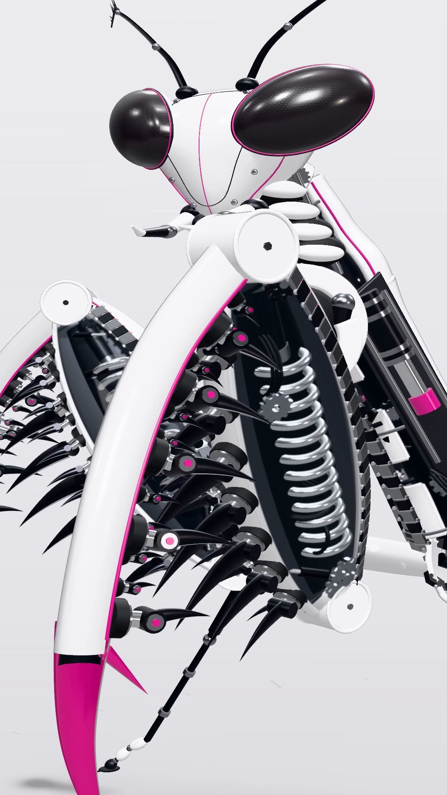

# ORCHIS MX-7 — 代码生成的机械螳螂 (three.js)

一只**全程用代码建出来**的机械螳螂：没有任何 3D 模型文件、贴图或图片导入，所有外壳、齿轮、弹簧、尖刺、翅膀都是 three.js 里的程序化几何；模型由一份 JSON 脚本同时驱动模型、镜头、页面 UI 和音效，再通过无头 Chrome 逐帧渲染成短片。

> 单图参考 → 纯代码建型 → 多视角静帧对照迭代 → 一键渲染"产品拆解"影片。



▶ 成片：[media/ORCHIS-MX7_v11.mp4](media/ORCHIS-MX7_v11.mp4)（1080×1920 竖版，34.6 s，H.264 + 合成音效）

## 项目状态（如实说明）

- **模型**：阶段候选，**未达到参考图精度**。头壳眼罩与侧壳衔接、胸颈轮廓、前臂装甲、腹部模块仍是已知差距，逐条记录在 [docs/R8-DELIVERY-REPORT.md](docs/R8-DELIVERY-REPORT.md)。
- **静帧验收**：R8 轮渲染 8 张 1600×900，每张脚本错误 0、非有限顶点坐标 0（原始记录见该轮的 render-checks.json，未随仓库发布）。技术检查 ≠ 美术验收。
- **影片**：v11 已出片（下方"已验证"一节有 ffprobe 实测参数）。
- 本项目是一轮 AI 辅助（Claude Code / Codex）与人协作的练习工程，过程文档全部保留在 [docs/](docs/)。

## 目录结构

```
web/     页面与模型本体（页面侧）
         mantis.js     模型：外壳/齿轮/关节/翅膀/260 个小件，全部程序化生成
         main.js       静帧镜头 SHOTS（hero / forearm / head / abdomen）+ 景深
         landscape.js  影片场：拆解列车、镜头路径、仪表盘 UI、音效线索
         behavior.js   待机生命层（前肢折叠弹击、弹簧泵、触角摆动、腹部呼吸）
         index.html    静帧页（?shot=hero|forearm|head|abdomen）
         landscape.html 影片页（读 ../film/landscape.json，可 ?script= 覆盖）
         film.html / vertical.html  早期 16:9 / 9:16 影片页
film/    脚本数据。landscape.json 是 v11 成片的实际驱动脚本，其余为历史版本
tools/   离线管线：无头 Chrome 逐帧截图、mp4 编码、测量与打包
         render.mjs / capture.mjs / vcapture.mjs / lifepreview.mjs   渲染
         measure.py / clearance.js / framemeter.py                   静帧指标测量
         package-*.py / sheet.mjs                                    对照图与打包
         clean_mix.py / makesfx.py / orbit_sound.py                   音效合成
docs/    制作规范、检查清单、逐轮执行方案、R8 交付记录
stills/  R8 静帧（本项目自己的渲染，不含参考图）
media/   v11 成片与封面帧
```

## 运行

需要：Node.js 20+、本机 Chrome（要 WebGL/GPU）、ffmpeg（出 mp4 时）、Python 3（部分打包/音效脚本，另需 Pillow / PyAV）。

```bash
npm ci                      # three + puppeteer-core（页面与渲染脚本都从这里取依赖）

# 1) 打开静帧页（任意静态服务器，仓库根目录起）
npx serve .                 # 然后访问 /web/index.html?shot=hero

# 2) 无头渲染静帧
node tools/render.mjs <输出目录> hero

# 3) 渲染短片（驱动 window.render(t) 逐帧出图再编码）
node tools/lifepreview.mjs <输出目录> hero 8 0 30
```

- 渲染脚本默认用 `C:/Program Files/Google/Chrome/Application/chrome.exe`，其它路径请设环境变量 `CHROME_PATH`。
- 页面按 `../node_modules/three/...` 解析 `three` 与 `three/addons/`，所以必须先 `npm ci`、并从仓库根目录起服务。
- 想要 GPU 而不是 SwiftShader，需要 `--use-angle=d3d11`（脚本里已带）和一块能跑 WebGL2 的显卡。

## 已验证 / 未验证

已验证：
- 成片 `media/ORCHIS-MX7_v11.mp4`：ffprobe 实测 1080×1920、30 fps、1038 帧、34.6 s、H.264 带音轨。
- 封面帧取自成片 t=3.2 s。
- 仓库内所有页面与脚本引用的相对路径都已按文件存在性核对。

未验证（本次发布未重跑）：
- 未在新环境重跑 `npm ci` → 渲染全流程，因此"clone 下来一条命令可用"未做端到端确认。
- 参考图未随仓库发布，逐条对照类工具（`tools/fitcam.py`、`tools/measure.py` 与 `compare_*.png` 对照图）无法直接复现，只能复现渲染本身。

## 方法来源与致谢

本项目的做法源自 **@Nyxera0x** 的 *3D Simulator* 系列：一张图 → 全程 three.js 建出机械生物 → 对照参考图迭代静帧 → 拍成"产品拆解"短片。作者公开的方法包 [github.com/nyxera0x/cutaway](https://github.com/nyxera0x/cutaway)（MIT）在本项目中只作为方法论参考，其代码、示例视频与示例素材均未复制进本仓库。

## 许可

本仓库**未声明开源许可证（No license declared — all rights reserved）**。代码与渲染成果可阅读、可学习，未授予再分发或商用许可；如需使用请先联系作者。上游方法包 `nyxera0x/cutaway` 为 MIT，其版权与许可归原作者。

## 本仓库发布说明

为了控制体积与版权边界，以下内容**未**发布：
- `rounds/`（约 10.6 GB / 22 000 个文件的逐轮渲染过程与中间视频）
- `node_modules/`、`__pycache__`、浏览器 profile 等运行产物
- 5 张 AI 参考图与对照图（含第三方参考画面）
- 第三方示例视频、上游 MIT 技能仓库克隆

发布前已做：敏感信息扫描（密钥/令牌 0 命中）、本机绝对路径清理（Chrome 路径改为 `CHROME_PATH` 环境变量）、只发布 v11 成片实际使用的代码快照。
